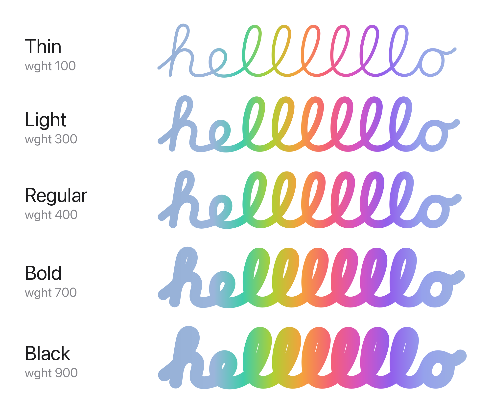
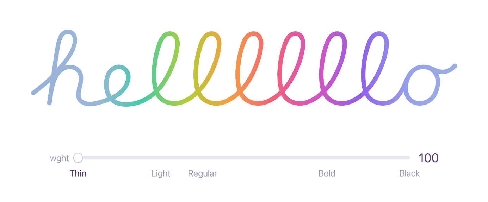
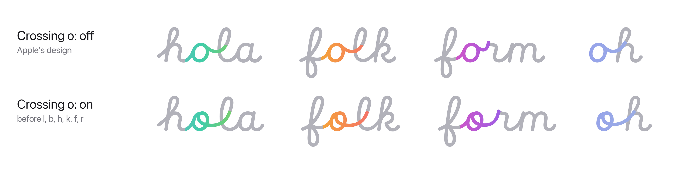
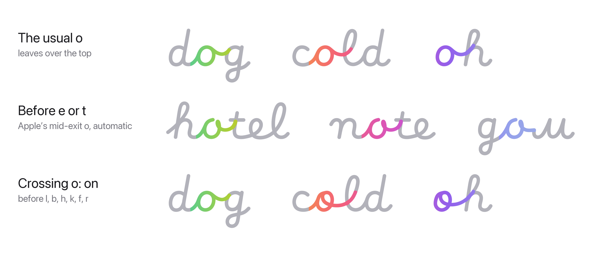
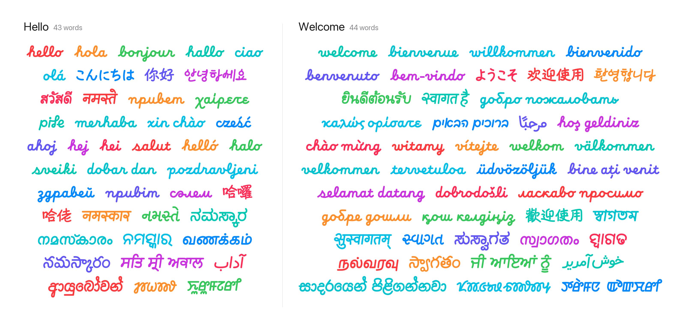

# Macintosh Skeletal Filled


The famoussss handwriting from Apple's **"hello"** screen, as fonts you can type with.

macOS 27 and iOS 27 ship a font called **Macintosh Skeletal** for the
personalized hello you see when setting up a new Mac or iPhone. On its own it
only contains the centre line of each stroke. Apple's renderer thickens those
strokes into tubes and joins the letters live. This project rebuilds what that
renderer draws as ordinary filled fonts, with joins that follow Apple's
renderer.

## Fonts

| File | Family | Weights |
|---|---|---|
| `fonts/MacintoshSkeletalVariable.otf` | Macintosh Skeletal Variable | Variable, `wght` 100 to 900 |
| `fonts/MacintoshSkeletalFilled.otf` | Macintosh Skeletal Filled | Static, Apple's on-screen weight |

Both fonts have two options, off by default: **Crossing o** and **Join
every letter** ([see below](#options)). With both off you get Apple's design.

### Variable weight





Weight is the pen thickness. Apple's renderer draws the font's strokes at
**1.55×** their stored radius, so that is the default (**Regular**).

| Style | `wght` | Pen thickness |
|---|---|---|
| Thin | 100 | 0.6× |
| ExtraLight | 200 | 0.92× |
| Light | 300 | 1.23× |
| **Regular** | **400** | **1.55× (Apple's hello screen)** |
| Medium | 500 | 1.74× |
| SemiBold | 600 | 1.93× |
| Bold | 700 | 2.12× |
| ExtraBold | 800 | 2.31× |
| Black | 900 | 2.5× |

Any value in between works. Thickness is linear in `wght` from Thin to
Regular and from Regular to Black, so every app shows the same result.
(Before this version Regular was `wght` 500, Light 270 and Bold 690.)

### Static or variable?

- **Static (Macintosh Skeletal Filled):** strokes are merged into one clean
  outline per glyph, and where two strokes meet the corner is softly
  blended, the way Apple's renderer does it. Choose this for the closest look
  to the hello screen.
- **Variable (Macintosh Skeletal Variable):** any weight from Thin to Black.
  Each stroke is its own round tube, overlapping the others, so junctions are
  a plain crease rather than a soft blend.

## Options

Both fonts have two options. They are off by default, and you can switch
each one on or off on its own, for any part of your text.

### Crossing o



The `o` from Apple's 2020 hello greetings: the bowl starts at the top, and
its end curls back inside and leaves through the bowl, rising straight into
the next letter. It's used before `l`, `b`, `h`, `k` and `f`, where the 2020
greetings use it (`hola`, `olá`, `dobar`); every other `o` stays Apple's.

### Join every letter


In Apple's design, some letters don't join the letter after them (see
[below](#why-some-letters-dont-join)). This option joins them all. It
replaces the separate *Macintosh Skeletal Variable Joined* font: if you
installed it, you can remove it in Font Book.

### How to switch them on

**Pages, Keynote, TextEdit:** select the text, press **⌘T** (Format › Font ›
Show Fonts), click the **⋯** button at the top left of the Fonts window and
choose **Typography…**. Under **Alternative Stylistic Sets**, tick
**Crossing o** and/or **Join every letter**. The weight (Thin to Black) is in
the font style menu of the Format sidebar.

**Figma:** select the text layer, click the **Type settings** button (the
sliders icon) in the Text section, open **Details** and switch on **Crossing
o** and/or **Join every letter** under **Stylistic sets**. The **Weight**
slider is in the same panel.

**CSS:**

```css
.hello {
  font-family: "Macintosh Skeletal Variable";
  font-feature-settings: "ss01" 1;   /* Crossing o */
  /* font-feature-settings: "ss02" 1;   Join every letter */
  /* font-feature-settings: "ss01" 1, "ss02" 1;   both */
}
```

Keep **Contextual Alternates** and **Ligatures** on (they are by default):
the joins are under both, so apps that apply either one join the letters.
Turn both off and each letter stands on its own.

## The o



Apple's font finishes an `o` in two ways. Usually the pen leaves over the
top into the next letter. Before `e` or `t` (Cyrillic `е`, `л`, `м`, `я`,
`ґ`, `љ`) it curls back past the middle in a small loop and runs into the
letter at mid-height. Apple's own joining rules choose the form, and these
fonts follow the same rules, so it happens automatically. The third kind,
the crossing `o`, is the [option](#crossing-o) above.


The hello-screen greetings aren't written with Apple's font. Each language
has its own pre-drawn path in macOS, made with Apple's internal versions of
the handwriting ("Macintosh Skeletal" 2.0 from 2025, and "Macintosh 3D" 1.1
from 2020), and their `o` is not one Apple's font has. In the 2025 "hola"
the join out of the `o` dips to mid-height and the `l` starts its loop
there. In the 2020 one the `o` is a stroke of its own whose end curls inside
the bowl and leaves through it. These fonts bring that 2020 `o` back as the
[Crossing o](#crossing-o) option, drawn from Apple's greeting and joined
with the fonts' own joins.

## Hello in every language



Apple's font also writes "hello" and "welcome" in scripts it has no letters
for: Thai, Japanese, Chinese, Korean, Arabic, Urdu, Hebrew, Sinhala and
eleven Indian scripts. Each greeting is a single hand-drawn glyph, and these
fonts keep them. There's nothing to switch on: type the whole word (or copy
it from the table) and it becomes the drawing when you finish the last
letter. Greetings in Latin, Greek and Cyrillic are ordinary joined letters,
so any word works there.

| Language | Hello | Welcome |
|---|---|---|
| Thai | สวัสดี | ยินดีต้อนรับ |
| Japanese | こんにちは | ようこそ |
| Korean | 안녕하세요 | 환영합니다 or 시작하기 |
| Chinese (Simplified) | 你好 | 欢迎使用 |
| Chinese (Taiwan) | 哈囉 | 歡迎使用 |
| Chinese (Hong Kong) | 哈佬 | 歡迎使用 |
| Hindi | नमस्ते | स्वागत है |
| Marathi | नमस्कार | सुस्वागतम् |
| Bangla | | স্বাগতম |
| Gujarati | નમસ્તે | સ્વાગત |
| Punjabi | ਸਤਿ ਸ੍ਰੀ ਅਕਾਲ | ਜੀ ਆਇਆਂ ਨੂੰ |
| Odia | ନମସ୍କାର | ସ୍ୱାଗତ |
| Kannada | ನಮಸ್ಕಾರ | ಸುಸ್ವಾಗತ |
| Malayalam | നമസ്കാരം | സ്വാഗതം |
| Tamil | வணக்கம் | நல்வரவு |
| Telugu | నమస్కారం | స్వాగతం |
| Manipuri (Meetei Mayek) | ꯈꯨꯔꯨꯝꯖꯔꯤ | ꯇꯔꯥꯝꯅ ꯑꯣꯛꯆꯔꯤ |
| Santali (Ol Chiki) | ᱡᱚᱦᱟᱨ | ᱥᱟᱹᱜᱩᱱ ᱫᱟᱨᱟᱢ |
| Sinhala | ආයුබෝවන් | සාදරයෙන් පිළිගන්නවා |
| Arabic | مرحبًا | |
| Urdu | آداب | خوش آمدید |
| Hebrew | שלום | ברוכים הבאים |

- The word has to match exactly. The fonts have no single letters in these
  scripts, so the letters stay invisible until the word is complete, and
  other text in these scripts needs another font.
- Apple drew the Manipuri, Santali and Sinhala greetings but never connected
  them to any text, and its Punjabi hello only worked in Apple's apps. These
  fonts connect them all, in Pages, Keynote and TextEdit as well as Figma
  and browsers.
- Malayalam has a second hello, with സ and ക stacked. Switch on **Stacked
  Malayalam hello** where you switch on the [options](#how-to-switch-them-on)
  (`ss03` in CSS).

## Why some letters don't join

The coloured strokes in the [image above](#join-every-letter) are the joins
the option changes. In Apple's design each is a short separate stroke that
starts beside the letter; with the option on it sweeps out of the letter
itself into the next one.

In Apple's design, some letters don't join the letter after them. The pen
lifts at the end of the letter, and the next letter starts on its own just
beside it. At Apple's weight the two only just touch; at lighter weights you
see a gap. This affects Latin `p`, Cyrillic `р`, `ф`, `б`, `э` and `ѕ`, Greek
`ρ`, `β` and `δ`, German `ß`, and a few others such as `ɔ` and `ɓ`.

**Join every letter** joins them all:

- For `p`, `р`, `ф`, `б`, `э` and `ѕ` it uses one-stroke forms that Apple
  drew and included in its font but never selects. The letter's last stroke
  sweeps straight into the next letter.
- For the others (`ρ`, `β`, `δ`, `ß`, `ɔ`, `ɓ`, ...) a connecting stroke
  leaves the letter body and runs into the next letter.

Apple's renderer never draws these joins, so their shapes are modelled on
Apple's other joins rather than recorded from it. Capitals and everything else
stay the same.

## Install

Download the `.otf` file you want and double-click it, then click
**Install** in Font Book. If you installed an earlier build, remove it in
Font Book first. Design apps such as Figma may need a restart to pick up the
new font.

## How it was made

- **Strokes:** each letter's centre lines and pen radii come from the
  private `strk` table in Apple's `MacintoshSkeletal.otf`. They are drawn as
  uniform cubic B-splines, with in-letter snapping and *injection* (a stroke
  flowing into another, like the lead-in of `a`, `d`, `g` or `q`) following
  Apple's rules.
- **Joins:** at every join Apple keeps each letter's own curve up to a fixed
  point and replaces the six control points around the boundary with three
  new ones. Those points were recorded from Apple's own renderer (in the iOS
  Simulator) for about 14,000 letter pairs across Latin, Greek and Cyrillic.
  In the font, contextual alternates insert a small zero-width bridge glyph
  between joined letters and swap in trimmed letter forms, so the joined
  curve is continuous.
- **Thickness:** Apple's renderer scales pen radii by 1.55, read from its
  shader settings.

## Known limitations

- About 6% of joins (mostly letters with a slash or bar, such as `ø` and
  `ӫ`) couldn't be read cleanly from Apple's renderer and use a fitted model
  instead, which is typically within a few font units.
- Apple's font has no ready-made accented letters (`é`, `ä`, `й`, `ё`, ...),
  only base letters and separate accents. These fonts add 606 of them, built
  from Apple's own base letter and accent, so they work in Pages, Keynote and
  other macOS apps as well as in Figma and browsers.
- With **Join every letter** on, the extra joins (after `p`, `р`, `ρ`, `ß`,
  ...) are modelled (see
  [Why some letters don't join](#why-some-letters-dont-join)). So are the
  joins out of the **Crossing o**: Apple's renderer never draws them.
- Apple's animation (the write-on, the glass shading) isn't part of a font.

## Troubleshooting

**Letters don't join, or there are blobs where they should join.** Every
join in these fonts comes from OpenType features: *contextual
alternates*, and (for apps that only offer that) *ligatures*. Make sure
they're on:

- **Pages, Keynote, TextEdit:** ⌘T › **⋯** › **Typography…** › **Contextual
  Alternates** should be ticked (it is by default).
- **Figma:** Type settings › **Details** › **Contextual alternates** should
  be on.
- **After Effects:** tick **Ligatures** in the Character panel (on by
  default). If the letters still don't join, remove any older copy of the
  font: versions before this one only had the joins under contextual
  alternates, which After Effects doesn't apply.

**The font, or its options, don't show up.** Check that the font is enabled
in Font Book and remove any older copy first (including the old
*Macintosh Skeletal Variable Joined*), then quit the app completely and
reopen it. The options are only in the fonts from this repository, not in
Apple's own *Macintosh Skeletal*.

**A greeting in Thai, Hindi, Japanese, ... shows nothing.** In these
scripts the fonts only have the whole words in
[Hello in every language](#hello-in-every-language). Copy the word from the
table so it matches exactly. Any other text in these scripts needs another
font.

**Pages or Keynote shows no weights.** Install the latest
`MacintoshSkeletalVariable.otf` from this repository; older builds were
marked italic, which hid the weight menu.

### Found something weird?

Please [open an issue](../../issues) on this repository with the text you
typed, the app (and its version) and a screenshot.

## License

This repository contains derivative works of Apple's font data. **The
letterforms, stroke data and design belong to Apple Inc.** This project is
not affiliated with or endorsed by Apple. It is shared for **personal,
non-commercial use** only. See [LICENSE](LICENSE).
